# 🎓 Online Learning Platform - Hệ thống Học Trực Tuyến

Nền tảng học trực tuyến cho phép **Giảng viên** tạo và quản lý khóa học, **Học viên** đăng ký - thanh toán - học tập trên cùng một hệ thống.

---

## 📋 Mục Lục

- [Tính Năng Chính](#-tính-năng-chính)
- [Công Nghệ Sử Dụng](#️-công-nghệ-sử-dụng)
- [Cấu Trúc Dự Án](#-cấu-trúc-dự-án)
- [Hướng Dẫn Chạy Nhanh](#-hướng-dẫn-chạy-nhanh)
- [Lộ Trình Phát Triển](#-lộ-trình-phát-triển)

---

## 📸 Demo & Giao Diện

### 👨‍🏫 Giao Diện Giảng Viên (Instructor)

#### Dashboard
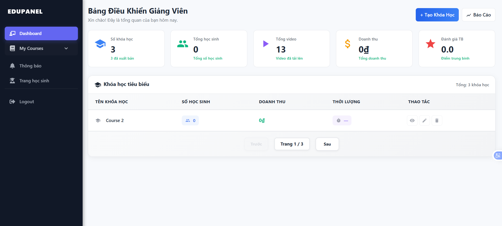
*Dashboard giảng viên với thống kê khóa học, học viên và doanh thu*

#### Danh Sách Khóa Học
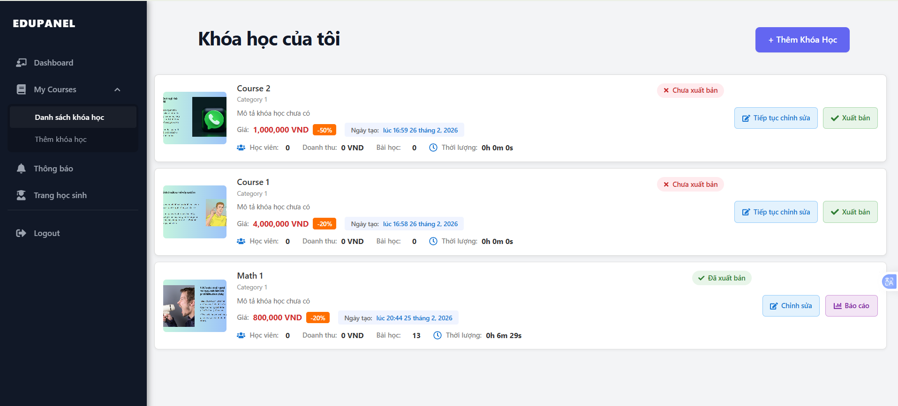
*Quản lý danh sách khóa học của giảng viên*

#### Thêm Mới Khóa Học
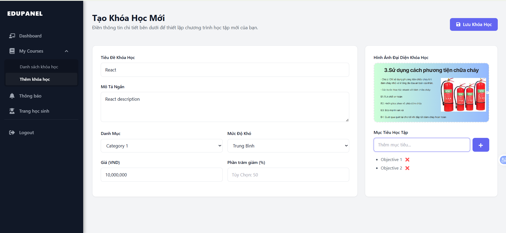
*Tạo khóa học mới với đầy đủ thông tin*

#### Chi Tiết Khóa Học
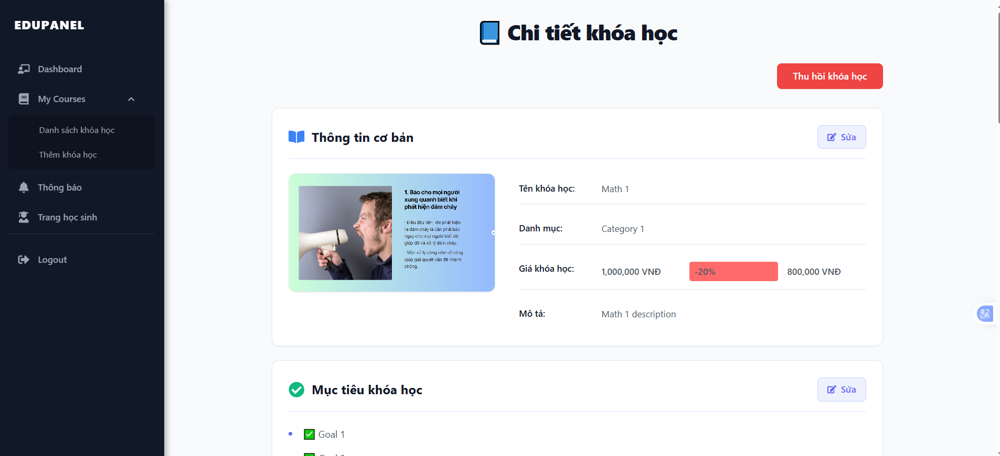
*Xem thông tin chi tiết và quản lý khóa học*

#### Quản Lý Bài Học
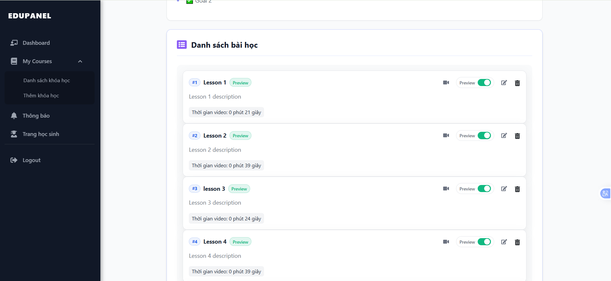
*Tổ chức bài học theo chương trong khóa học*

#### Xem Bài Học
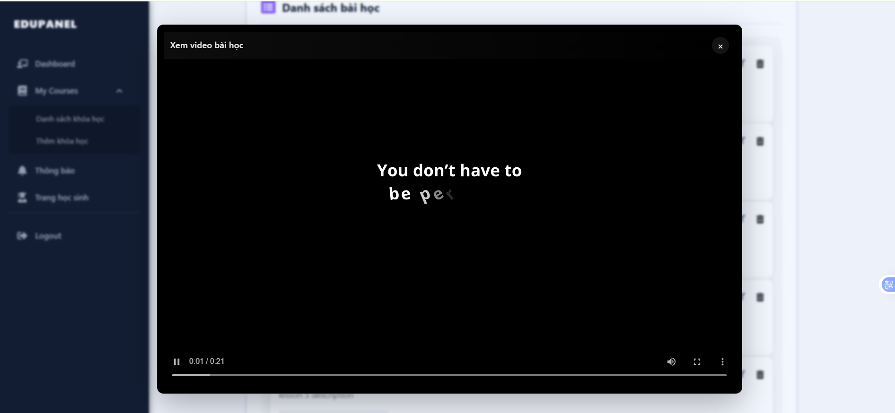
*Xem nội dung bài học đã tạo*

---

### 👨‍🎓 Giao Diện Học Viên (Student)

#### Trang Chủ 1
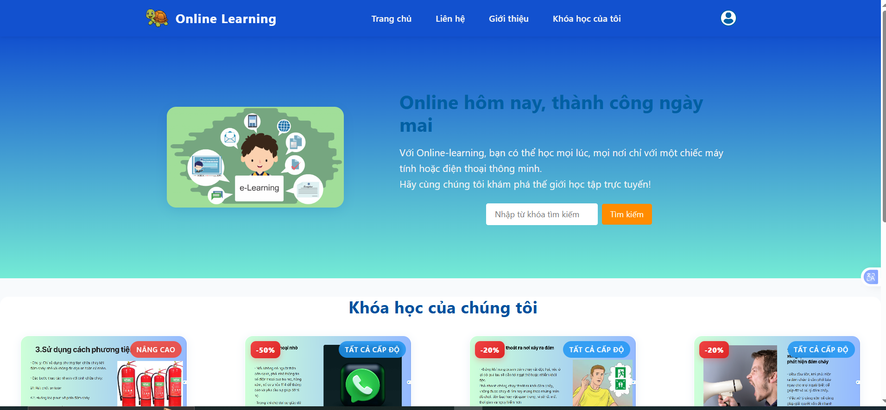
*Trang chủ với danh sách khóa học nổi bật*

#### Trang Chủ 2
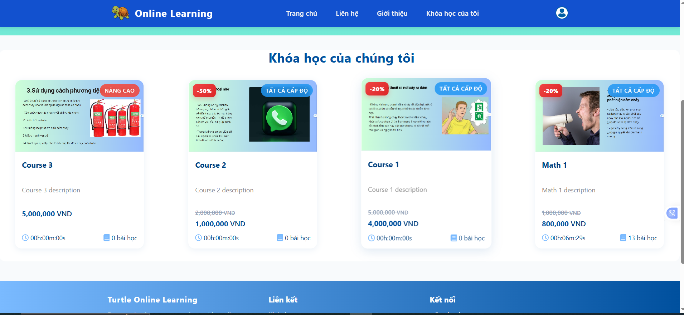
*Khám phá thêm khóa học theo danh mục*

#### Các Khóa Học Của Tôi
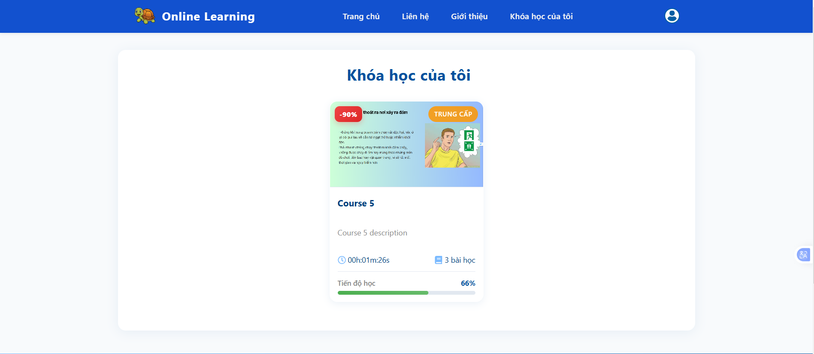
*Quản lý danh sách khóa học đã đăng ký*

#### Chi Tiết Khóa Học
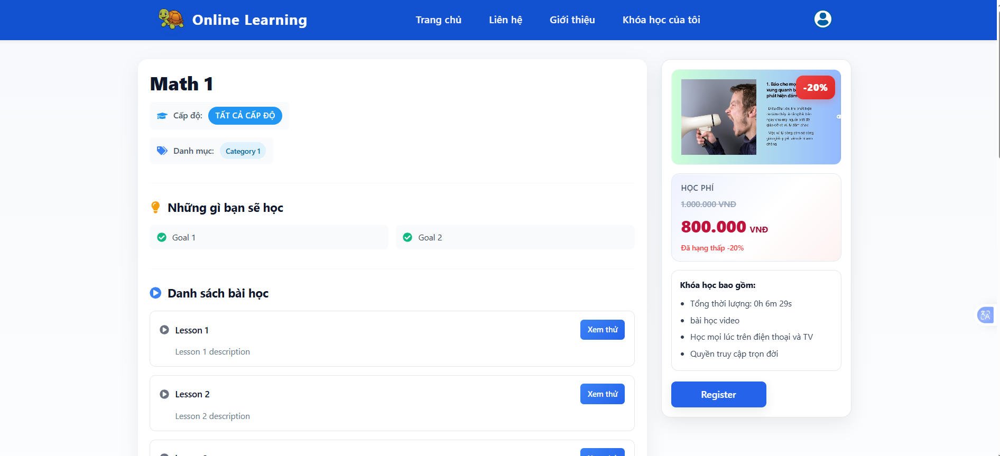
*Xem thông tin chi tiết khóa học trước khi đăng ký*

#### Học Tập
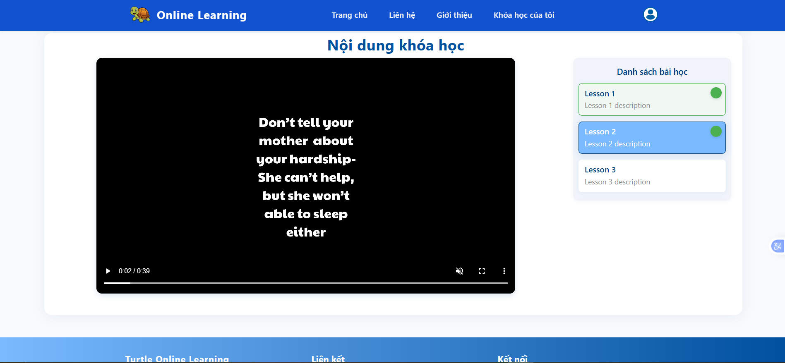
*Tham gia bài học và theo dõi tiến độ*

#### Xem Trước Bài Học
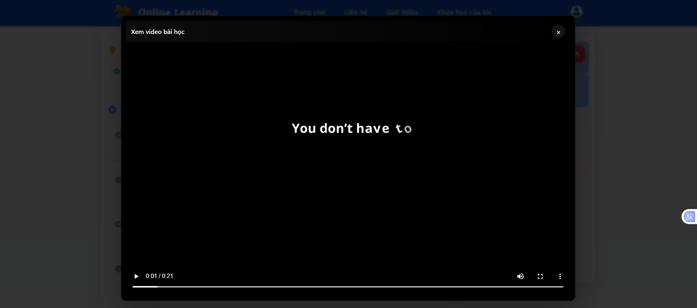
*Xem nội dung bài học chi tiết*

---

## 🚀 Tính Năng Chính

### 👨‍🏫 Dành cho Giảng viên
- ✅ Quản lý khóa học (thêm/sửa/xóa)
- ✅ Quản lý bài học, chương, tài liệu, video
- ✅ Publish/Unpublish khóa học
- ✅ Dashboard thống kê

### 👨‍🎓 Dành cho Học viên
- ✅ Tìm kiếm và khám phá khóa học
- ✅ Đăng ký khóa học
- ✅ Theo dõi tiến độ học
- ✅ Thanh toán qua ZaloPay

### 🛡️ Hệ Thống & Bảo Mật
- ✅ Đăng ký/đăng nhập
- ✅ JWT Authentication (blacklist token qua Redis)
- ✅ Spring Security phân quyền

---

## 🛠️ Công Nghệ Sử Dụng

### Backend
- Java 21, Spring Boot 3.3 (Maven)
- Spring Security + JWT, Spring Cloud Eureka
- PostgreSQL (Flyway quản lý schema)
- Redis (JWT blacklist & cache)
- Apache Kafka (sự kiện thông báo email)
- AWS S3 / Cloudflare R2 (lưu trữ file, video)
- FFmpeg (xử lý video, lấy thời lượng)

### Frontend
- React.js (CRA, port 3000)
- SCSS/SASS, Redux, Axios
- Firebase (lưu trữ)
- ZaloPay (thanh toán)

### Hạ tầng local
- Docker Compose: PostgreSQL, Redis, Kafka (+ Zookeeper), Kafka UI

---

## 📁 Cấu Trúc Dự Án

> Lưu ý: các thư mục `plan/`, `weeklyReport/`, `finalReport/` là tài liệu nội bộ, đã ignore và **không đẩy lên GitHub**.

```
online_learning/
├── README.md
├── demoImages/
└── source_code/
    ├── online_learning_client/              # Frontend React (port 3000)
    │   ├── FRONTEND_RUN_GUIDE.md
    │   ├── .env                             # REACT_APP_BASE_URL (tạo từ .env.example)
    │   ├── package.json
    │   ├── public/
    │   └── src/
    └── servers/                             # Toàn bộ backend
        ├── eureka-server/                   # Service Discovery (port 8761)
        ├── services/
        │   └── notification/                # Email notification consumer qua Kafka (port 8081)
        ├── online_learning_server/           # API chính (port 8080, context-path /online_learning)
        │   ├── BACKEND_RUN_GUIDE.md
        │   ├── docker-compose.yaml          # PostgreSQL, Redis, Kafka, Kafka UI
        │   ├── .env-example / .env          # Biến môi trường (JWT, DB, Redis, Zalopay, storage...)
        │   ├── pom.xml
        │   └── src/
        ├── docs/                            # Thiết kế nghiệp vụ, ER, sequence
        └── memory-bank/                     # Context dự án
```

---

## 💻 Hướng Dẫn Chạy Nhanh

### 0) Điều kiện cần

| Công cụ | Phiên bản |
| :--- | :--- |
| Java (JDK) | 21 |
| Maven | 3.8+ |
| Node.js | 18+ |
| Docker & Docker Compose | bắt buộc (Postgres, Redis, Kafka) |
| FFmpeg | bắt buộc cho tính năng video (cấu hình trong `application.properties`) |

### 1) Khởi động hạ tầng (Docker Compose)

File `docker-compose.yaml` nằm trong thư mục `online_learning_server/` (cùng level với `pom.xml`):

```bash
cd source_code/servers/online_learning_server
docker compose up -d
```

Các service chạy lên:

| Service | Port | Ghi chú |
| :--- | :--- | :--- |
| PostgreSQL | 5432 | user `root` / pass `12345` / db `online_learning_db` — schema tự tạo bởi **Flyway** khi backend khởi động, không cần chạy SQL thủ công |
| Redis | 6379 | JWT blacklist & cache |
| Kafka (Confluent) | 9092 | Broker sự kiện (zookeeper kèm theo) |
| Kafka UI | 8090 | Xem topic tại `http://localhost:8090` |

Kiểm tra: `docker compose ps`.

### 2) Chạy Backend (API chính)

Tài liệu chi tiết: [BACKEND_RUN_GUIDE.md](source_code/servers/online_learning_server/BACKEND_RUN_GUIDE.md)

```bash
cd source_code/servers/online_learning_server

# .env đã có sẵn trong repo với giá trị mặc định chạy local
# (chỉ cần sửa ffmpeg.path và các key storage/Zalopay nếu bạn dùng riêng)
# Nạp .env rồi chạy với profile dev (DB/Redis đúng với docker-compose):
powershell -Command "Get-Content .env | Where-Object { $_ -and ($_ -notmatch '^\s*#') } | ForEach-Object { $p = $_ -split '=',2; if ($p.Count -eq 2) { [System.Environment]::SetEnvironmentVariable($p[0].Trim(), $p[1].Trim(), 'Process') } }; mvn spring-boot:run -Dspring-boot.run.profiles=dev"
```

> Nếu chưa có `.env` (bị gitignore khi clone lại): copy từ `.env-example`, điền `JWT_SIGNER_KEY` và các key khác, rồi tạo thêm `DB_URL`, `DB_USERNAME`, `DB_PASSWORD`, `FRONTEND_URL`, `REDIS_HOST`, `REDIS_PORT` theo bảng trong BACKEND_RUN_GUIDE.
>
> ⚠️ `application.properties` (không kèm profile) **không khai báo `spring.datasource`**, nên luôn cần bật một profile:
> - **`dev`** (khuyến nghị): DB/Redis đã khớp docker-compose, không cần thêm biến DB.
> - **`prod`**: `--spring.profiles.active=prod` và cung cấp `DB_URL`, `DB_USERNAME`, `DB_PASSWORD`, `REDIS_HOST`/`REDIS_PORT` qua `.env`/biến môi trường.

- Backend: `http://localhost:8080/online_learning`
- Swagger UI: `http://localhost:8080/online_learning/swagger-ui/index.html`

**Service phụ (tuỳ chọn):**

```bash
# Eureka (chạy trước khi chạy backend nếu muốn đăng ký service discovery)
cd source_code/servers/eureka-server && mvn spring-boot:run        # http://localhost:8761

# Notification (email qua Kafka)
# Đặt thêm SPRING_MAIL_USERNAME / SPRING_MAIL_PASSWORD trước khi chạy
# (thư mục này không có file .env, nên phải set biến trong shell):
$env:SPRING_MAIL_USERNAME="you@gmail.com"; $env:SPRING_MAIL_PASSWORD="app-password"
cd source_code/servers/services/notification; mvn spring-boot:run
```

### 3) Chạy Frontend

Tài liệu chi tiết: [FRONTEND_RUN_GUIDE.md](source_code/online_learning_client/FRONTEND_RUN_GUIDE.md)

```bash
cd source_code/online_learning_client

# Tạo file .env (bị gitignore):
#   REACT_APP_BASE_URL=http://localhost:8080/online_learning
npm install
npm start
```

Truy cập **http://localhost:3000**.

---

## 🧪 Test & Build

```bash
# Chạy test backend (H2 + application-test.properties)
cd source_code/servers/online_learning_server
mvn test

# Build production
mvn clean package -DskipTests
java -jar target/online_learning-0.0.1-SNAPSHOT.jar --spring.profiles.active=prod
```

---

## 📅 Lộ Trình Phát Triển

- [ ] Hoàn thiện hệ thống báo cáo chi tiết cho giảng viên
- [ ] Tích hợp thông báo qua Email (skeleton Kafka + notification service đã có, cần cấu hình SMTP)
- [ ] Thêm tính năng chat trực tiếp giữa giảng viên và học viên
- [ ] Xây dựng forum thảo luận cho mỗi bài học

---

## 📞 Hỗ Trợ

Nếu gặp vấn đề khi cài đặt hoặc chạy dự án:
1. Kiểm tra hạ tầng: `docker compose ps` (Postgres/Redis/Kafka phải `Up`).
2. Xem mục troubleshooting trong:
   - [source_code/online_learning_client/FRONTEND_RUN_GUIDE.md](source_code/online_learning_client/FRONTEND_RUN_GUIDE.md)
   - [source_code/servers/online_learning_server/BACKEND_RUN_GUIDE.md](source_code/servers/online_learning_server/BACKEND_RUN_GUIDE.md)
3. Kiểm tra `.env` của backend có đủ biến (đặc biệt `JWT_SIGNER_KEY`).
4. Kiểm tra logs trong terminal và browser console.

---

## 📄 License

Dự án phục vụ mục đích học tập và nghiên cứu.

---

**Chúc bạn triển khai thành công! 🎉**
